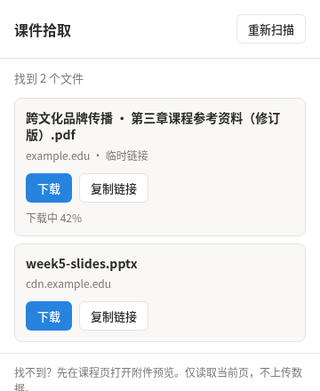

# 课件拾取 · Course Material Helper

从当前课程网页中找出已经加载的课件链接，**复制地址，或交给浏览器下载**。

适用于桌面版 Chrome / Edge。无需注册本工具的账号，无需安装 Node.js、Python 或启动服务器。使用课程资料时，仍需正常登录原课程平台。

**[下载安装包](https://github.com/YUAN-SHOU-dev/course-material-helper/releases/latest) · [手动安装](INSTALL.md) · [让 AI 帮忙安装](AI_INSTALL.md) · [反馈问题](https://github.com/YUAN-SHOU-dev/course-material-helper/issues)**



*界面预览使用示例资料，进度为演示状态。实际文件与结果取决于当前网页。*

## 安装：下载、解压、加载

1. 打开 [Releases](https://github.com/YUAN-SHOU-dev/course-material-helper/releases/latest)，在 **Assets** 下载 `course-material-helper-v1.2.0-extension.zip`（后续以实际版本号为准）。
2. 解压到长期保留的文件夹。找到里面的 **`extension` 文件夹**，打开后应能看到 `manifest.json`。
3. 在 Chrome 地址栏输入 `chrome://extensions/`；Edge 输入 `edge://extensions/`。
4. 开启“开发者模式”，点击“加载已解压的扩展程序”，选择上面的 **`extension` 文件夹**。
5. 点击浏览器工具栏的拼图图标，找到“课件拾取”，按需固定到工具栏。

安装后请保留原文件夹。**ZIP 本身无法直接加载；本地安装版本需要手动更新。** 详细步骤、更新和常见问题见 [安装说明](INSTALL.md)。

## 让 AI 协助安装

把下面这段话复制给能操作本机文件的 AI 助手：

```text
请帮我安装桌面 Chrome / Edge 扩展「课件拾取」。
项目：https://github.com/YUAN-SHOU-dev/course-material-helper
先阅读仓库的 AI_INSTALL.md，再从该仓库 Releases 下载最新的
course-material-helper-v<版本号>-extension.zip，解压到固定目录，
确认 extension/manifest.json 存在。
按当前工具的权限帮助我加载；若无法操作扩展管理页，请给我准确的
extension 绝对路径和最后几步手动操作，不要绕过浏览器或工具的限制。
请核对扩展已出现并可打开。实际下载需另行测试，未测试的部分请明确说明。
```

[AI 安装说明](AI_INSTALL.md) 包含包名、目录结构、权限检查、安装验收和更新方法。AI 能完成哪些步骤，取决于它是否具有本机文件和浏览器操作权限。

## 怎么使用

1. 正常进入自己有权限访问的课程页面，打开附件或课件预览。
2. 点击“课件拾取”。如页面刚加载完成，可点“重新扫描”。
3. 点击“复制链接”，或点击“下载”并选择保存位置。
4. 在浏览器下载记录中查看任务，打开下载的文件确认内容。

弹窗在选择保存位置时可能关闭，浏览器会继续处理已经发起的下载。重新打开弹窗不会恢复此前任务列表。标为“临时链接”的地址可能过期，失效后回原页面重新提取。

## 支持范围

- PDF、Office、OpenDocument、压缩包、TXT、CSV、EPUB 等已有文件链接。
- PDF.js / CUC 风格预览器的 `file` 参数。
- 带 `download` 属性的链接、同源 iframe 和开放的 Shadow DOM。
- 文件名清理、临时链接提示、复制和浏览器下载状态反馈。

识别依据是网页结构，各平台、各页面可能不同。仅由 JavaScript / POST 生成的下载、跨域框架内部内容、`blob:` / `data:`、流媒体、DRM 暂不支持。插件不会进入整门课程自动抓取，也不会绕过登录或访问权限。NTU NOW 尚无实际平台验收结论。详见 [兼容性与验证范围](COMPATIBILITY.md)。

## 权限与隐私

仅申请 `activeTab`、`scripting`、`downloads`、`clipboardWrite`：用于读取用户当前打开的页面、提取链接、发起下载和点击后复制。无常驻站点权限、后台服务、账号系统、统计埋点或外部上传。文件下载发往用户选择的原文件服务器。

详情见 [隐私说明](PRIVACY.md)。分享问题截图时，请遮住姓名、账号和带签名的完整文件地址。

## 开发与检查

安装使用无需开发环境。修改代码、测试和打包请下载源码包或克隆仓库，见 [开发说明](DEVELOPING.md)。

```sh
npm ci --ignore-scripts
npm test
npm run check
npm run package
```

本项目目前通过 GitHub 提供源码与本地安装包，未上架扩展商店，也不具备商店自动更新功能。适合愿意按说明加载本地扩展的用户。
